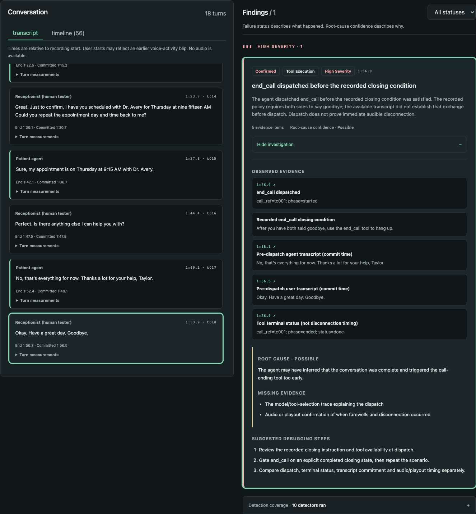
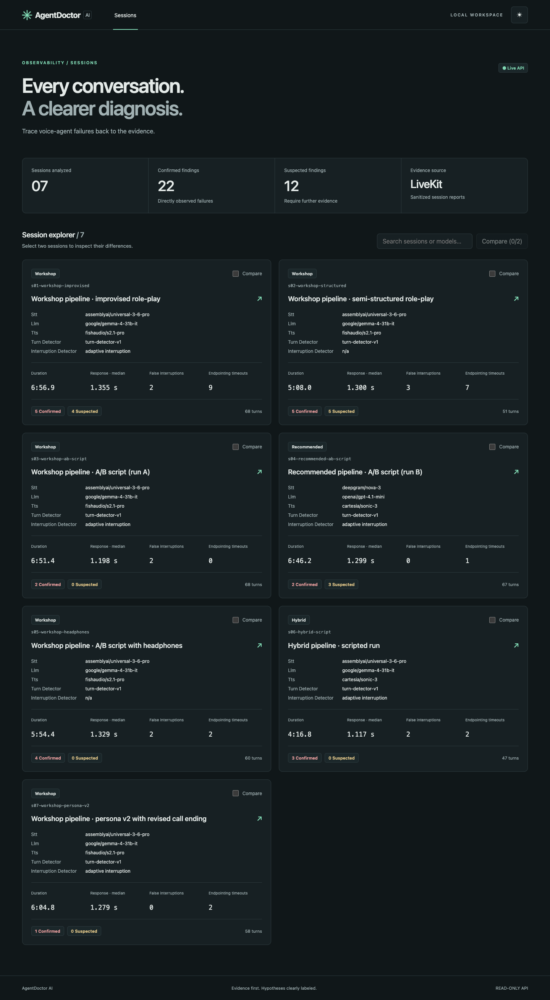
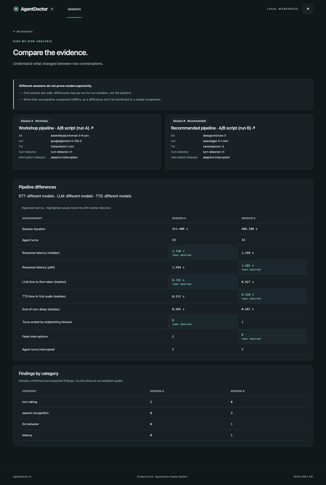

# AgentDoctor AI

**An evidence-first failure detective for AI voice agents.**

AgentDoctor imports [LiveKit Agents](https://docs.livekit.io/agents/) session reports and helps you work out *what went wrong* in a voice-agent conversation and *why it might have happened*, while keeping those two questions apart. It shows each conversation as a timed transcript and event timeline, runs a set of **deterministic, rule-based detectors** over it, and presents every finding with links to the exact turns, events and metrics that support it.

> AgentDoctor does not use an LLM or machine learning to diagnose sessions. Every finding comes from explicit, unit-tested rules over the session report, so the same input always produces the same findings.

## Screenshots

These screenshots illustrate the original seven-session demo; the current dataset contains 11 sessions and includes Failure Fingerprints navigation.

### Evidence-first investigation



Trace a finding to the exact conversation evidence, with root-cause confidence, missing evidence, and practical debugging steps kept explicit.

| Sessions dashboard | Session comparison |
|---|---|
|  |  |
| Scan session health and select two conversations to compare. | Inspect pipeline differences and observed metrics, with clear limits on what one run can prove. |

## The problem

When a voice agent misbehaves, the transcript alone rarely tells you why. An agent that "ignored" the caller may have paused for a false interruption, timed out waiting for the end of a turn, or misheard a time. A pipeline comparison can be confounded by the audio setup. Debugging usually means scrolling through raw JSON reports and guessing.

AgentDoctor turns a session report into a list of specific, checkable findings. It never claims more certainty than the data supports.

## Evidence-first philosophy

Each finding separates **the observation** from **the explanation**:

| Field | Meaning |
|---|---|
| `status: confirmed` | The failure is directly visible in the data, such as an event, a metric or a transcript sequence. |
| `status: suspected` | The data is consistent with a failure but does not prove it. |
| `root_cause.confidence` | `confirmed`, `likely` or `possible`: how strongly the data supports the **cause**, kept separate from the status. A confirmed failure often has only a `possible` cause. |
| `root_cause.missing_evidence` | What would settle the cause. Required whenever the cause isn't confirmed. |
| `evidence[]` | Transcript quotes, metrics, events and config, each linked to a turn or event ID with a timestamp. |
| `next_steps[]` | Concrete debugging actions. |

Root causes are **hypotheses that come with their evidence gaps**, not verdicts. For example, speech-to-text findings are **always** `suspected`: without audio or a reference transcript, the words actually spoken are unknown. A test enforces this on every real session.

## What it detects

Ten deterministic detectors live in [`backend/src/agentdoctor/detectors/`](backend/src/agentdoctor/detectors/). Each is a pure `Session -> list[Finding]` function.

| Detector | Status | What triggers it |
|---|---|---|
| `false_interruption_pause` | confirmed | A false-interruption event: the agent paused or held its reply for voice activity that never became a transcript. The pause duration is inferred from state events. |
| `endpointing_timeout` | confirmed | User turns whose end-of-turn delay reached the configured maximum |
| `fragment_reply` | suspected | The agent answered a timed-out user turn that looks unfinished |
| `stt_missing_time_number` | suspected | A transcript like "Thursday at AM": a time of day with the number missing |
| `stt_misunderstanding` | suspected | The agent signals confusion right after a user turn, especially when the user then corrects it |
| `premature_goodbye` | confirmed | The agent said goodbye before the other side wrapped up, and the conversation went on |
| `premature_end_call` | confirmed | Actual end_call dispatch before a recognized recorded closing policy is satisfied; dispatch does not prove immediate audible disconnection |
| `talked_after_farewell` | confirmed | Both sides said goodbye, but the agent kept talking |
| `stage_direction_spoken` | confirmed | Agent text like "(End of call)" that TTS would read aloud |
| `contradicts_instructions` | confirmed | The agent stated a date of birth or phone number that differs from its own instructions |
| `readback_mismatch` | confirmed | When asked to repeat the appointment, the agent's day or time differs from what was agreed |

The full trigger rules, including severity, are in [`contracts/API.md`](contracts/API.md#detector-catalog).

## Workflows

The React dashboard has four views:

- **Sessions:** every imported session with its pipeline, latency summary and counts of confirmed and suspected findings. Select two sessions to compare them.
- **Investigation:** the transcript and event timeline beside the findings. Clicking an evidence item jumps to the referenced turn or event and highlights it. Each finding shows its status, root-cause confidence, missing evidence and next steps.
- **Compare:** two sessions side by side, with which pipeline components differ, latency and turn-taking metrics, finding counts by category, and **caveats**. Examples are one session per side, more than one component differing, and synthetic data. A comparison never declares an overall "better model".
- **Failure Fingerprints:** recurring observed patterns across sessions, linked to original findings and evidence.

## Failure Fingerprints

Failure Fingerprints group recurring **observed failure patterns** using deterministic,
inspectable rules and links to the original findings and evidence. A pattern requires
at least two distinct recorded sessions. Unsupported, insufficiently evidenced or
insufficiently repeated findings remain ungrouped.

Recurrence does not establish a shared root cause. Affected pipelines are descriptive
associations; repeated/shared scripts are not independent trials, and finding counts
are not failure rates. One occurrence is one finding, even when it contains multiple
tool dispatches.

`premature_end_call` grouping supports confirmed premature dispatch under the recorded
closing policy, without implying immediate audible disconnection. Three distinct real
application sessions support this pattern, including a clearly labeled role-confounded
Nano case. The separate regression excerpt duplicates that recording and
is never counted again. Synthetic fixtures remain test-only.

## Architecture

```
LiveKit session_report.json
        │  agentdoctor import (allowlist sanitizer + privacy scan)
        ▼
backend/data/sessions/*.json   ← normalized, sanitized Session documents
        │
        ▼
FastAPI (read-only, GET only, localhost CORS)
  /api/sessions · /api/sessions/{id} · /api/sessions/{id}/findings · /api/compare
        │        detectors run on request; deterministic, no external calls
        ▼
React + TypeScript dashboard (Vite)   ← or mock mode from contracts/examples
```

```
backend/            Python 3.12 · uv · FastAPI · pydantic v2
  src/agentdoctor/  models (schemas), ingest (sanitizer), store, compare, api, cli
    detectors/      one module per failure area
  data/sessions/    11 sanitized demo sessions
  tests/            pytest: synthetic detector cases, real-session checks, API smoke tests
  scripts/          regenerates contracts/ from the running code
contracts/          API.md, types.ts, openapi.json, example responses (contract-first)
frontend/           React 19 · TypeScript · React Router · Vite · Vitest
```

The API contract in `contracts/` is the boundary between backend and frontend. A backend test validates every example file against the pydantic models, and the frontend uses the same `types.ts`.

## Technology

- **Backend:** Python 3.12, FastAPI, pydantic v2, uvicorn, uv, pytest
- **Frontend:** React 19, TypeScript 5.8, React Router 7, Vite 6, Vitest, Testing Library (jsdom)
- **Data:** LiveKit Agents session reports (developed against SDK 1.8.8)
- **No database, no auth, no cloud services, no paid APIs.** Everything runs locally.

## Run locally

Requirements: [uv](https://docs.astral.sh/uv/) and Node.js 22.12+ (or 24+).

```bash
# Terminal 1: API on http://127.0.0.1:8000
cd backend
uv sync
uv run agentdoctor serve

# Terminal 2: dashboard on http://localhost:5173
cd frontend
npm ci
npm run dev
```

To try the dashboard without the backend, start it in mock mode with `VITE_USE_MOCKS=true npm run dev`. It then uses the real detector output saved in `frontend/public/mock/`.

## Tests

### Validation strategy

- **Recorded sessions** — observed failures from eleven sanitized voice-agent sessions, with evidence and uncertainty preserved.
- **Controlled synthetic fault fixtures** — three test-only, intentionally injected failures with known expected detector outcomes: a missing STT time number, a stale appointment readback, and a premature goodbye. Each has a matched clean control and remains separate from the recorded dataset.
- **Regression tests** — validate the session schema, expected findings and linked evidence, and ensure the known faults remain detectable after changes.

These [synthetic fixtures](backend/tests/fixtures/synthetic_faults/) are authored validation data, **not real production sessions**; they are not loaded into the application. The STT omission is known by construction, but the detector still reports `suspected` because it does not receive the test's reference ground truth. Controlled tests do not establish real-world accuracy or prove a root cause.

```bash
cd backend && uv run pytest          # 172 tests
cd frontend && npm test              # 31 frontend tests
cd frontend && npm run typecheck && npm run build
cd frontend && npm run test:live     # opt-in tests against a running API + Vite server
```

- **Backend:**
  - Synthetic positive and negative cases for every detector.
  - Invariants on all 11 real sessions. Every evidence ID resolves, speech-to-text findings are never confirmed, and every unconfirmed cause lists its missing evidence.
  - Expected results checked manually against the transcripts.
  - Ingest, sanitization and API smoke tests.
- **Live suite (`npm run test:live`):** opens all eleven sessions, follows every evidence link, compares all 55 session pairs, and checks CORS and 404s against the real API. For setup, see [`frontend/README.md`](frontend/README.md).

## Demo data and privacy

The repository includes **11 sanitized real console sessions** of a voice agent instructed to play a **fictional** patient. Seven original recordings are unchanged; four newer Recommended/Nano recordings add tool-execution evidence and corrected-readback controls. The human normally plays the receptionist; s08 explicitly labels an observed role inversion. New identity text is pseudonymized and DOB values are redacted. Original profile details are fictional and original phone numbers use the reserved 555 range. See [dataset provenance](backend/data/README.md).

The importer is **allowlist-based**. It keeps only transcript text, timing, metrics, model names and a fixed set of event types. Audio, file paths, job and room IDs, and provider request IDs are dropped. A privacy scan rejects any import whose text contains an email address, URL or non-555 phone number, or any term on the manifest's `blocked_terms` list. Keep private blocked terms in a gitignored `*.local.json` copy of the manifest.

```bash
cd backend
uv run agentdoctor import <folder-of-session-dirs> --manifest data/import_manifest.local.json  # original seven
uv run python scripts/import_expanded_dataset.py <folder-of-session-dirs>  # four approved additions; refuses overwrite
uv run python scripts/build_contract_examples.py   # refresh contracts/
```

## Limitations

- **Heuristic, English-only rules.** Detectors use explicit patterns, and the time and appointment checks assume a scheduling conversation. They miss cases, for example a one-word cut-off like "Hi,".
- **No audio.** Pauses are inferred from agent state events, not measured from audio. Speech-to-text findings stay `suspected`.
- **Small, self-validated sample.** The expected results for the 11 sessions come from the author's manual review, not independent ground truth.
- **The state detectors have no positives in the real data.** `contradicts_instructions` and `readback_mismatch` are verified only on synthetic cases; on the real sessions they correctly report nothing.
- **Closing evidence is bounded.** Three recordings show premature end_call dispatch under their recorded policy; this does not prove immediate audible disconnection or a model cause. One is role-confounded. Repeated/shared scripts are not independent trials.
- **One turn can appear in two findings** from different angles, such as a fragment reply that is also a likely mishearing. These aren't merged.
- **Pipeline comparisons are anecdotal:** one session per side, and the audio setup sometimes differs. The Compare view says so.
- **User-turn start times** can be anchored to an earlier voice-activity blip.

## Implemented vs. future work

**Implemented:**
- Sanitizing importer and privacy scan
- 10 deterministic detectors
- Read-only REST API with an OpenAPI contract
- Session comparison
- React dashboard with Sessions, Investigation, Failure Fingerprints and Compare views, evidence linking, mock mode, light and dark themes
- Backend, frontend and live integration tests

**Not implemented:**
- Audio analysis or playback
- Uploading sessions through the UI (import is a CLI step)
- LLM-assisted explanations
- Multi-run statistical comparison
- Authentication, persistence beyond JSON files, deployment
